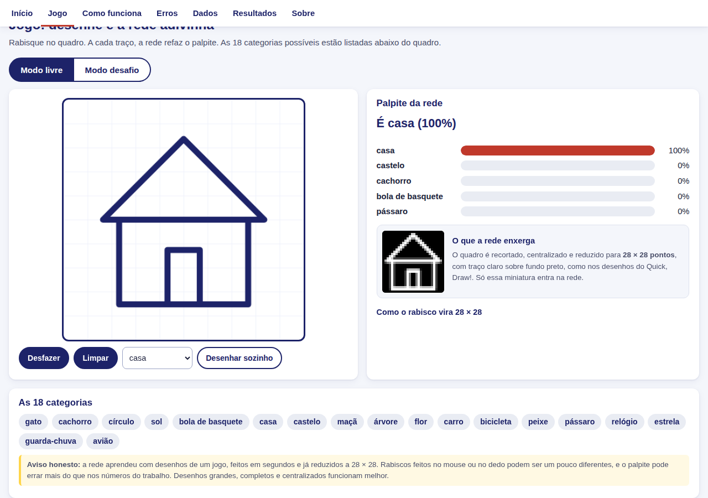

<p align="center"></p>

# Adivinha o Desenho: laboratório interativo de Deep Learning

[](LICENSE)
[](https://epineto.github.io/quickdraw-dl-unisinos/)

**Demonstração: <https://epineto.github.io/quickdraw-dl-unisinos/>**



Aplicação web (HTML, CSS e JavaScript puros, 100% no navegador, sem dependências e sem build) do **Trabalho 02 de Deep Learning 2026/2** (PPGCA/Unisinos). Uma CNN com 80.434 parâmetros reconhece 18 categorias de rabiscos do Quick, Draw!. A inferência está implementada em JavaScript (convolução, ReLU, pooling, camada densa e softmax) e lê os pesos de `data/cnn_quickdraw.json`.

## Seções
| Âncora | O que há |
|---|---|
| `#inicio` | Apresentação e demonstração automática |
| `#jogo` | Quadro de desenho (mouse e toque), top-5 em tempo real, miniatura 28 × 28 que a rede enxerga, desfazer, limpar, desenho automático e modo desafio (5 rodadas, tempo e pontos) |
| `#como-funciona` | Preparo do desenho, passo a passo pelas camadas (mapas de ativação), lupa 3 × 3 deslizante e mapa de calor por oclusão |
| `#erros` | Matriz de confusão interativa, exemplos de erros e pares mais confundidos |
| `#dados` | Galeria por categoria e lupa de pixels |
| `#resultados` | Baseline × MLP × CNN, curva de aprendizado, robustez (com teste ao vivo), calibração e acerto por categoria |
| `#sobre` | Limites, créditos e licenças |

## Pré-processamento (igual ao dos dados de treino)
Os traços são guardados como listas de pontos. Calcula-se a caixa envolvente, o desenho é escalado (sem deformar) para o lado maior medir 26 pontos, centralizado em 28 × 28 e pintado com espessura fixa de 1,7 ponto, com suavização 4 × 4. O código está em `src/core/rasterizar.js`.

## Como rodar
```bash
python3 -m http.server 8000     # abrir http://localhost:8000
node --test tests/              # Node 18 ou mais novo
```
Os testes comparam a inferência em JavaScript com os logits do PyTorch (`tests/amostras_teste.json`, 42 amostras, tolerância 1e-4; erro observado: cerca de 9e-6) e verificam o pré-processamento, as transformações e o mapa de oclusão. Os pesos foram regravados com 7 algarismos significativos por `tools/reexportar_pesos.py`.

## Código de treino e notebook (Python)
A pasta [`codigo/`](codigo) tem o que gerou os números: `baixar-dados.py` (baixa as primeiras 12.000 linhas de cada categoria do Quick, Draw!), `quickdraw.py` (modelos, treino, aumento de dados, avaliação e calibração), `treinar.py` (todos os experimentos), `gerar-figuras.py`, `exportar-pesos.py` (pesos para este laboratório) e o notebook completo. Os resultados (CSV e JSON) estão em [`resultados/`](resultados).

[](https://colab.research.google.com/github/epineto/quickdraw-dl-unisinos/blob/main/codigo/Trabalho02-DL-QuickDraw.ipynb)

O notebook é autossuficiente: instala o que faltar, baixa os dados e funciona no computador e no Google Colab, sem GPU. No Colab, o padrão é o modo `RAPIDO` (poucos minutos, números diferentes dos do relatório); para o treino completo, trocar para `RAPIDO = False`.

```bash
cd codigo
python baixar-dados.py          # cria ../dados/quickdraw-subconjunto.npz
python treinar.py --rapido      # teste rápido; sem --rapido, treino completo (dezenas de minutos em CPU)
python gerar-figuras.py
```
Requisitos: Python 3.10 ou mais novo, PyTorch (CPU), NumPy e Matplotlib. Os scripts esperam as pastas `dados/`, `resultados/`, `modelos/` e `figuras/` ao lado de `codigo/`; `dados/`, `modelos/` e `figuras/` são criadas na execução e não estão no repositório.

## Limites
Imagens de 28 × 28 de um jogo; rabiscos no mouse ou no dedo diferem do treino. Só 18 categorias. Traço muito grosso derruba a rede (ver `#resultados`).

## Créditos e licenças
- Subconjunto usado, sem compactação (arquivos `.npy` + CSV de categorias): [pasta pública no Google Drive](https://drive.google.com/open?id=1jaatjHdugsKNDyADAryGf6p8E6Qt5UOR)
- Desenhos: [Quick, Draw!](https://github.com/googlecreativelab/quickdraw-dataset), Google Creative Lab, **CC BY 4.0** (subconjunto de 18 categorias, bitmaps 28 × 28).
- Ha, D.; Eck, D. *A Neural Representation of Sketches*. arXiv:1704.03477, 2017.
- Código: licença MIT (`LICENSE`). Autor: Epitácio Vicente do Nascimento Neto.
